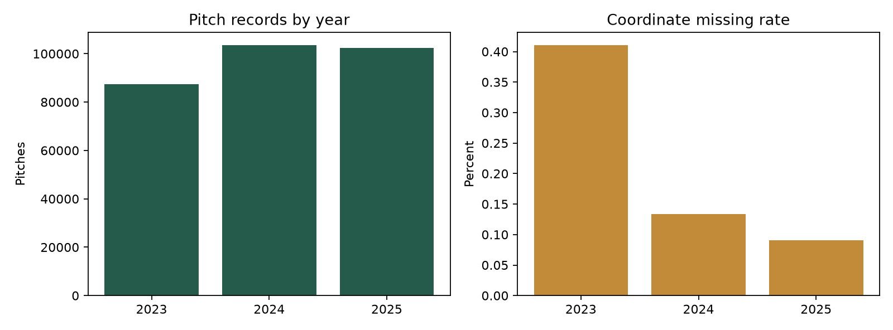
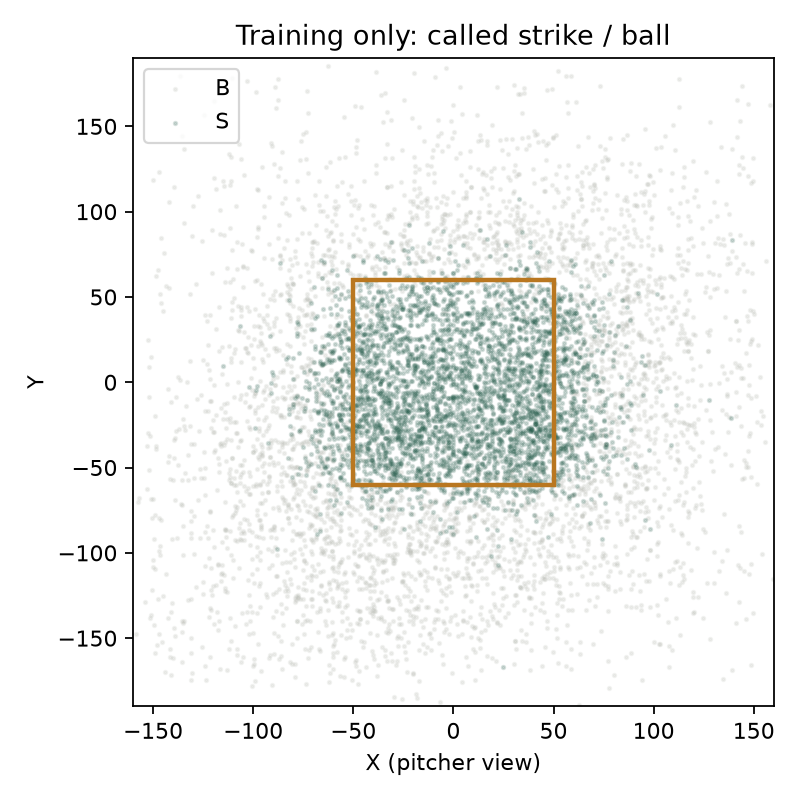

# 第一週資料與基準成果

來源：[主辦方官網](https://blog.rebas.tw/articles/4136) → [Rebas Open Data](https://github.com/rebas-tw/rebas.tw-open-data)。

共 1,020 場例行賽、293,482 筆投球事件；日期 2023-04-01 至 2025-10-06。
只讀取單場 JSON；ZIP 內合併檔不重複計算。未納入季後挑戰賽、台灣大賽或 2026 年資料。

## 年度資料品質

| 年度 | 場數 | 投球數 | 座標缺值 | 球速缺值 | 可用情境 |
|---|---:|---:|---:|---:|---:|
| 2023 | 300 | 87,374 | 0.41% | 4.10% | 97.11% |
| 2024 | 360 | 103,620 | 0.13% | 3.13% | 97.65% |
| 2025 | 360 | 102,488 | 0.09% | 5.47% | 97.36% |

## 時間切分

- 訓練：2023 年及 2024-08-16 以前的 2024 年完整比賽。
- 驗證：2024-08-16 至 2024-09-12 以前。
- 校準：2024-09-12 起的 2024 年比賽，保留供第二週使用。
- 測試：2025 年完整保留，本週未計算模型測試成績。
- 以 2024 年比賽日期的 70%／85% 分位分界；同日比賽不跨集合，分界不依標籤調整。

## 驗證集球種預測

| 基準 | 筆數 | Log loss | Top-1 | Top-2 |
|---|---:|---:|---:|---:|
| league_count | 16,491 | 1.5941 | 45.24% | 62.91% |
| pitcher_count_shrunk | 16,491 | 1.2446 | 48.57% | 74.99% |

## 查核結果與限制

- 末球前球數重建不符的打席：1,325；受影響資料不進入情境基準。
- 無法由當場成績表唯一對應 ID 的投手事件：0；打者事件：0。
- 同名不同 ID 與同 ID 多名稱均保留獨立查核清單，不按姓名全域合併。
- 前段球數由事件重建，最後一球的出局／壘包與分數以 PA 的末球前欄位核對。
- 跑者紀錄未提供起終點壘位；中途有移動時，無法可靠推算的壘包標未知，不硬補。
- 延長局起始壘包未假定為空壘；不完整半局不作完整半局期望得分標籤。
- 分區採寬 100、高 120 的座標定義；帶外以正規化偏離較大的軸分區，角落不重疊。
- 座標缺值與離群值不當作零；球速僅保留 40–180 的可解析值並記錄剔除。
- 雜訊圖只使用訓練資料，呈現人工落點與裁判判定的綜合差異，尚未估計可分離的儀器誤差。
- 目前為投手／球數頻率基準，打者只用於樣本查核；未聲稱完成打者特徵、序列模型或 conformal。
- 推薦以訓練期狀態價值與歷史候選失分變化平滑排序；稀疏情境主要依賴較大群體，並非因果策略效果。

詳細機讀結果：`data_audit.json`、`split_manifest.json`、`baseline_metrics.json`。
重跑：在專案根目錄執行 `.venv\Scripts\python.exe scripts/build_week1.py`。
