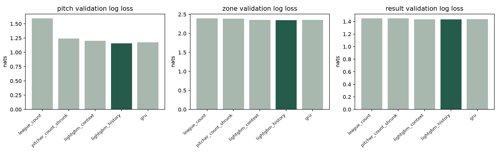

# 第二週模型比較與校準成果

本文件由實際訓練輸出的 `metrics.json` 自動產生。2025 最終測試集未載入、未打分、未選模或校準。

Smoke：False；實驗 seed：20261110。

## 相同驗證樣本的三任務比較

下表為未校準驗證結果；log loss 與 ECE 越低越好。各任務的缺標籤遮罩在所有模型間相同。

| 模型 | 任務 | n | log loss | top-1 | top-2 | ECE |
|---|---|---:|---:|---:|---:|---:|
| league_count | pitch | 16,486 | 1.594000 | 45.24% | 62.91% | 0.015019 |
| league_count | zone | 16,470 | 2.392752 | 18.29% | 33.81% | 0.005662 |
| league_count | result | 16,486 | 1.448795 | 35.98% | 62.42% | 0.009676 |
| pitcher_count_shrunk | pitch | 16,486 | 1.244698 | 48.56% | 74.99% | 0.015605 |
| pitcher_count_shrunk | zone | 16,470 | 2.388548 | 18.76% | 34.71% | 0.005464 |
| pitcher_count_shrunk | result | 16,486 | 1.448795 | 35.98% | 62.42% | 0.009676 |
| lightgbm_context | pitch | 16,486 | 1.201012 | 49.55% | 77.24% | 0.034751 |
| lightgbm_context | zone | 16,470 | 2.352341 | 21.68% | 38.23% | 0.006256 |
| lightgbm_context | result | 16,486 | 1.434537 | 36.16% | 63.08% | 0.014733 |
| lightgbm_history | pitch | 16,486 | 1.158778 | 51.21% | 78.76% | 0.026350 |
| lightgbm_history | zone | 16,470 | 2.348361 | 22.09% | 38.35% | 0.004808 |
| lightgbm_history | result | 16,486 | 1.433694 | 36.47% | 63.02% | 0.014803 |
| gru | pitch | 16,486 | 1.174469 | 50.86% | 78.39% | 0.028728 |
| gru | zone | 16,470 | 2.355157 | 21.96% | 38.20% | 0.009052 |
| gru | result | 16,486 | 1.436815 | 36.59% | 62.68% | 0.017077 |

## 事前規則下的選模

選定：`lightgbm_history`。

lightgbm_history is the simplest eligible model within 0.005 nats of best validation pitch log loss (1.158778).

規則：validation pitch log loss; within 0.005 nats prefer context LGB then history LGB then GRU; GRU zone/result may degrade at most 0.03 nats vs history LGB。

模型資源仍需獨立 API 服務驗收；本訓練程序不代表 Render 記憶體或線上延遲。

## 排除與有效歷程

| 分割 | 原始球數 | 可用球數 | 排除 | 特殊結果 | 缺分區 | 有效非空歷程 |
|---|---:|---:|---:|---:|---:|---:|
| train | 159,910 | 155,502 | 4,408 | 554 | 321 | 113,903 |
| validation | 16,924 | 16,486 | 438 | 58 | 16 | 12,028 |
| calibration | 14,160 | 13,811 | 349 | 46 | 13 | 10,105 |

## 消融

所有消融沿用同一驗證集與固定訓練預算，單任務模型僅報訓練過的球種 head。

| 配置 | 任務 | n | log loss | top-1 | ECE |
|---|---|---:|---:|---:|---:|
| gru_no_sequence | pitch | 16,486 | 1.216175 | 48.94% | 0.036412 |
| gru_no_sequence | zone | 16,470 | 2.363117 | 21.40% | 0.008677 |
| gru_no_sequence | result | 16,486 | 1.441769 | 35.86% | 0.016236 |
| gru_no_shrinkage | pitch | 16,486 | 1.175239 | 50.83% | 0.026011 |
| gru_no_shrinkage | zone | 16,470 | 2.356395 | 22.03% | 0.008665 |
| gru_no_shrinkage | result | 16,486 | 1.438327 | 36.44% | 0.014727 |
| gru_single_task | pitch | 16,486 | 1.177849 | 51.04% | 0.030568 |
| lightgbm_history_jitter | pitch | 16,486 | 1.159630 | 51.09% | 0.026218 |
| lightgbm_history_jitter | zone | 16,470 | 2.349661 | 22.05% | 0.008528 |
| lightgbm_history_jitter | result | 16,486 | 1.433295 | 36.33% | 0.016532 |

座標抖動訓練尺度：X σ=1.5304、Y σ=1.8365，由訓練 X IQR 固定推得；未改動驗證／校準。

## 獨立校準與 conformal audit

| 階段 | 起始日期 | 結束日期 | 完整日期數 | 場數 | 可用球數 |
|---|---|---|---:|---:|---:|
| temperature | 2024-09-12 | 2024-09-21 | 9 | 20 | 5,516 |
| conformal | 2024-09-22 | 2024-10-01 | 7 | 18 | 5,099 |
| audit | 2024-10-05 | 2024-10-11 | 7 | 12 | 3,196 |

| 任務 | T | audit n | log loss 前 | log loss 後 | ECE 前 | ECE 後 | 實測覆蓋率 | 平均集合大小 |
|---|---:|---:|---:|---:|---:|---:|---:|---:|
| pitch | 1.0238 | 3,196 | 1.105942 | 1.105271 | 0.040633 | 0.034434 | 89.83% | 2.516896 |
| zone | 1.0012 | 3,193 | 2.362307 | 2.362289 | 0.008969 | 0.008215 | 90.26% | 10.270905 |
| result | 1.0238 | 3,196 | 1.452363 | 1.451989 | 0.031346 | 0.027021 | 89.46% | 3.580413 |
| conditional_result | 1.0012 | 3,193 | 1.153360 | 1.153379 | 0.021146 | 0.019402 | — | — |

名目覆蓋率為 90%；audit 未參與溫度或分位數擬合。時間漂移與觀測選擇偏差仍可能存在，實測覆蓋率不等於未來實戰保證。條件結果 head 另作溫度校準，不套用主結果 head 的集合覆蓋率。

## 訓練樣本數分組的驗證結果

分組只依訓練期樣本數定義。直接投打對戰從未出現、1–29、30–99、100 以上分開報告；空組保留 n=0。

| 分組 | 球種 n | 球種 log loss | 球種 top-1 | 分區 log loss | 結果 log loss |
|---|---:|---:|---:|---:|---:|
| batter_unseen | 139 | 1.132589 | 58.27% | 2.390156 | 1.519416 |
| batter_1_99 | 515 | 1.082756 | 57.48% | 2.410380 | 1.470307 |
| batter_100_499 | 2,507 | 1.131959 | 52.17% | 2.346176 | 1.460165 |
| batter_500_plus | 13,325 | 1.167036 | 50.72% | 2.345941 | 1.426404 |
| history_empty | 4,458 | 1.165848 | 53.05% | 2.397154 | 1.361778 |
| history_available | 12,028 | 1.156158 | 50.53% | 2.330302 | 1.460348 |
| pitcher_under_100 | 1,605 | 1.452978 | 47.60% | 2.374898 | 1.432535 |
| pitcher_100_plus | 14,881 | 1.127047 | 51.60% | 2.345500 | 1.433819 |
| matchup_unseen | 4,860 | 1.220924 | 52.12% | 2.360508 | 1.443601 |
| matchup_1_29 | 8,205 | 1.123660 | 51.46% | 2.339163 | 1.430668 |
| matchup_30_99 | 3,309 | 1.155884 | 49.14% | 2.353024 | 1.426532 |
| matchup_100_plus | 112 | 1.120369 | 55.36% | 2.357304 | 1.437134 |

## 匯出一致性與運算條件

預算：`{"epochs": 10, "lgb_rounds": 140, "threads": 4, "gru_batch_size": 1024}`。

| GRU 配置 | 實際 epochs | 最大 NumPy／PyTorch 機率誤差 |
|---|---:|---:|
| gru | 10 | 2.09e-07 |
| gru_no_sequence | 10 | 2.68e-07 |
| gru_no_shrinkage | 10 | 2.38e-07 |
| gru_single_task | 10 | 2.38e-07 |

訓練、比較與校準共 111.6 秒。

完整方法、速度與歷程遮罩、推薦因果限制，參閱 [MODELING_METHOD.md](MODELING_METHOD.md)。
