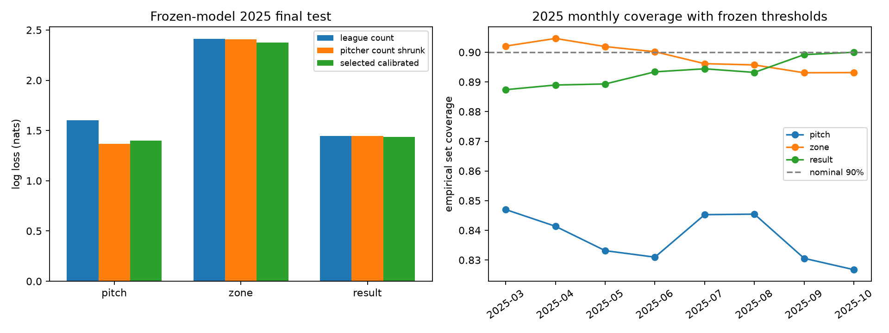

# 2025 凍結模型最終測試

執行日期：2026-11-11。此報告在第二週選模與校準完成後才開啟 2025 最終測試；未重訓、選模、重估溫度或 conformal 分位數。

凍結版本：`week2-sequence-v1`；訓練截止 `2024-08-14`。

SHA-256：`aa3e984758796843bce68aa71fb06a4c84739a7d8048be475cc1bfe6855671ec`。第一次讀取測試資料前寫入 [凍結紀錄](freeze_before_final_test.json)，推論後再確認模型位元組、encoder 與校準器未變。

## 樣本與遮罩

測試期間 `2025-03-29` 至 `2025-10-06`，360 場，原始 102,488 球，共同可用 99,729 球。

凍結 API 名單內投打組合 69,044 球；名單外 30,685 球亦以未知 ID 特徵評估，但線上 API 不開放未知 ID。缺少落點 68 球只遮罩分區與條件結果任務。

| 排除原因（依序、互斥） | 球數 |
|---|---:|
| invalid_state | 2,702 |
| invalid_identity | 0 |
| unsupported_pitch_type | 39 |
| unsupported_result | 18 |

特殊結果原值：`{"hit_by_pitch": 337}`。完整重疊旗標與未知球種計數見 JSON。

所有模型在同一批列／目標遮罩上比較；基準的七類結果頻率投影至相同五類。ECE 使用 15 個等寬信心區間；log loss 為 nats，越低越好。條件結果 head 只評估已觀測球種與落點，不是推薦換球後的因果收益。

## 全部共同可用樣本

| 模型 | 任務 | n | log loss | top-1 | top-2 | ECE | 90% 集合覆蓋率 | 平均集合大小 |
|---|---|---:|---:|---:|---:|---:|---:|---:|
| selected_calibrated | pitch | 99,729 | 1.400057 | 50.29% | 74.18% | 0.051070 | 83.74% | 2.593388 |
| selected_calibrated | zone | 99,661 | 2.377184 | 21.02% | 36.83% | 0.009793 | 89.85% | 10.295793 |
| selected_calibrated | result | 99,729 | 1.438629 | 36.48% | 62.82% | 0.014238 | 89.32% | 3.520541 |
| selected_calibrated | conditional_result | 99,661 | 1.154955 | 55.12% | 76.88% | 0.005038 | — | — |
| selected_raw | pitch | 99,729 | 1.407021 | 50.29% | 74.18% | 0.057575 | — | — |
| selected_raw | zone | 99,661 | 2.377221 | 21.02% | 36.83% | 0.009994 | — | — |
| selected_raw | result | 99,729 | 1.438885 | 36.48% | 62.82% | 0.018527 | — | — |
| selected_raw | conditional_result | 99,661 | 1.154940 | 55.12% | 76.88% | 0.005080 | — | — |
| league_count | pitch | 99,729 | 1.600752 | 46.43% | 62.28% | 0.004947 | — | — |
| league_count | zone | 99,661 | 2.410551 | 17.88% | 32.72% | 0.003669 | — | — |
| league_count | result | 99,729 | 1.444851 | 36.18% | 62.90% | 0.005988 | — | — |
| league_count | conditional_result | 99,661 | 1.184786 | 54.71% | 76.38% | 0.035043 | — | — |
| pitcher_count_shrunk | pitch | 99,729 | 1.368926 | 49.27% | 70.70% | 0.009700 | — | — |
| pitcher_count_shrunk | zone | 99,661 | 2.408195 | 17.95% | 32.93% | 0.007071 | — | — |
| pitcher_count_shrunk | result | 99,729 | 1.444851 | 36.18% | 62.90% | 0.005988 | — | — |
| pitcher_count_shrunk | conditional_result | 99,661 | 1.184786 | 54.71% | 76.38% | 0.035043 | — | — |

球種 log loss 相對投手頻率基準變化為 **+2.27%**（負值代表改善）；這是已凍結模型的最終測試結果，沒有依此改選模型。

**不能宣稱全面優於投手基準**：全部可用列的球種 log loss 較差，但名單內子集改善 3.56%；top-1 與機率品質反映不同面向。訓練未見投手 26,931 球的固定集合覆蓋率只有 68.86%，顯示未知 ID 路徑的限制。名單內子集也不是新測試集，不能用來隱藏全部樣本的退步。

## 線上名單內子集

| 模型 | 球種 n | 球種 log loss | 球種 top-1 | 分區 log loss | 結果 log loss |
|---|---:|---:|---:|---:|---:|
| selected_calibrated | 69,044 | 1.225868 | 52.27% | 2.368154 | 1.439295 |
| selected_raw | 69,044 | 1.228575 | 52.27% | 2.368184 | 1.439540 |
| league_count | 69,044 | 1.588880 | 47.10% | 2.405676 | 1.445182 |
| pitcher_count_shrunk | 69,044 | 1.271066 | 50.97% | 2.402534 | 1.445182 |

## 訓練期樣本數與 OOD 分組

分組只由凍結 encoder 與 baseline 訓練期計數定義，沒有累加 2025 次數。直接對戰使用原基準訓練球數；特殊結果是否納入依凍結原表，不重算。空組保留 n=0。

| 分組 | 球種 n | 球種 log loss | 球種 top-1 | 球種集合覆蓋 | 分區覆蓋 | 結果覆蓋 |
|---|---:|---:|---:|---:|---:|---:|
| pitcher_unseen | 26,931 | 1.872289 | 44.75% | 68.86% | 89.50% | 88.92% |
| pitcher_1_99 | 5,087 | 1.776213 | 47.12% | 78.02% | 87.21% | 87.58% |
| pitcher_100_499 | 12,388 | 1.315751 | 52.92% | 85.91% | 88.84% | 88.51% |
| pitcher_500_plus | 55,323 | 1.154467 | 52.69% | 91.02% | 90.50% | 89.86% |
| batter_unseen | 5,195 | 1.396594 | 51.20% | 82.27% | 91.02% | 88.74% |
| batter_1_99 | 3,551 | 1.372113 | 53.59% | 83.81% | 88.98% | 90.99% |
| batter_100_499 | 17,106 | 1.366462 | 50.93% | 84.81% | 90.04% | 90.63% |
| batter_500_plus | 73,877 | 1.409423 | 49.92% | 83.59% | 89.77% | 88.98% |
| matchup_unseen | 52,820 | 1.593848 | 48.46% | 77.82% | 89.52% | 89.08% |
| matchup_1_29 | 33,691 | 1.178726 | 52.91% | 90.11% | 90.21% | 89.44% |
| matchup_30_99 | 12,458 | 1.189664 | 50.92% | 91.12% | 90.27% | 89.87% |
| matchup_100_plus | 760 | 1.192072 | 51.18% | 91.97% | 90.53% | 91.32% |
| history_empty | 26,739 | 1.465441 | 52.06% | 82.16% | 91.08% | 84.20% |
| history_available | 72,990 | 1.376105 | 49.64% | 84.32% | 89.41% | 91.20% |

## 月別時間漂移

| 月 | 球種 n | 球種 log loss | 球種 ECE | 球種覆蓋 | 分區覆蓋 | 結果覆蓋 |
|---|---:|---:|---:|---:|---:|---:|
| 2025-03 | 817 | 1.368377 | 0.025154 | 84.70% | 90.21% | 88.74% |
| 2025-04 | 17,102 | 1.402132 | 0.058991 | 84.14% | 90.47% | 88.90% |
| 2025-05 | 15,847 | 1.423104 | 0.056644 | 83.32% | 90.19% | 88.93% |
| 2025-06 | 16,127 | 1.423667 | 0.071320 | 83.10% | 90.02% | 89.34% |
| 2025-07 | 11,802 | 1.365978 | 0.050566 | 84.53% | 89.62% | 89.44% |
| 2025-08 | 18,345 | 1.358739 | 0.039014 | 84.55% | 89.57% | 89.32% |
| 2025-09 | 16,249 | 1.425176 | 0.048782 | 83.06% | 89.31% | 89.92% |
| 2025-10 | 3,440 | 1.399019 | 0.041609 | 82.67% | 89.32% | 90.00% |

2024 校準 audit 與 2025 測試的差異同時包含球員、月份與資料分布改變，不能歸因於單一原因。每月樣本相關，未以獨立逐球假設宣稱信賴區間。

## 校準與限制

| 任務 | 2024 audit log loss | 2025 log loss | 2024 audit 覆蓋 | 2025 覆蓋 |
|---|---:|---:|---:|---:|
| pitch | 1.105271 | 1.400057 | 89.83% | 83.74% |
| zone | 2.362289 | 2.377184 | 90.26% | 89.85% |
| result | 1.451989 | 1.438629 | 89.46% | 89.32% |
| conditional_result | 1.153379 | 1.154955 | — | — |

名目 90% 集合沒有在測試集調整；若低於 90% 即如實保留。分區集合可能涵蓋多數區域，應同時看集合大小，而非只看覆蓋。

推薦只用觀測資料的條件結果與訓練期 ΔRE；人工落點是實際位置，並非瞄準意圖，不能宣稱推薦改善實際失分。

模型內 `test_evaluated=false` 是第二週匯出當下的歷史訓練紀錄，保留原位元組以維持 SHA；本第三週報告的 `test_evaluated=true` 表示後續已實施最終評估。

實際評估耗時 26.5 秒，完整 [最終測試 JSON](final_evaluation.json)、[供產品顯示的摘要](final_evaluation_public.json)。重新執行 `rtk proxy .venv\Scripts\python.exe scripts/evaluate_final.py` 只重現同一凍結評估，不重訓。

資料：[Rebas Open Data](https://github.com/rebas-tw/rebas.tw-open-data)，[ODC-By 授權](https://github.com/rebas-tw/rebas.tw-open-data/blob/main/LICENSE)。
