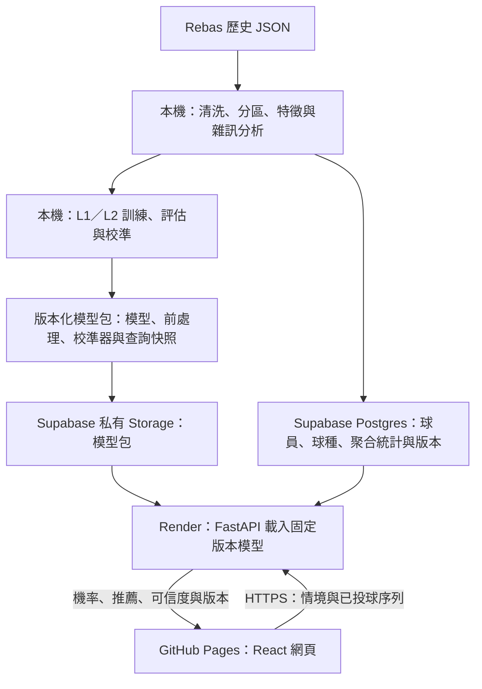

# 專案計畫書 v3：球路參謀（PitchAdvisor TW）—動態網頁版

> 題目方向：**投手對戰攻略產生器**（「面對這名打者，我該怎麼投？」）  
> 版本日期：2026-11-11（第三週交付更新）
> 開發週期：三週，免費部署優先  
> 核心架構：**GitHub Pages 前端＋Supabase 資料服務＋FastAPI 雲端推論**

本文件為完整的 v3 計畫書，保留 v2 原檔。所有本機專案文件、程式碼、資料與模型產物，均放在 `C:\Users\user\Desktop\炫晟\野革盃` 及其子資料夾。

目前專案狀態（更新2026-11-11）：第三週已完成2025凍結最終評估、可靠等待與錯誤處理、三組唯讀固定案例、本機完整推論與封裝、冷啟動與有限並發驗收，以及九頁成果簡報與五分鐘Demo腳本。網站核心已發布並通過三平台查核，4分40秒字幕影片與最後封存亦已完成。模型維持week2-sequence-v1：2025全體99729球的球種log loss比投手頻率基準差2.27%，名單內69044球改善3.56%，全體球種集合覆蓋83.74%；未再用測試調參。隔夜冷啟動51.514秒恢復，暖機HTTP p95250.96ms，4客戶端20次請求全成功。

實作紀錄以 [第三週交付](docs/week3/COMPLETION.md)、[2025最終報告](docs/week3/FINAL_RESULTS.md)、[離線指南](docs/week3/OFFLINE_GUIDE.md)、[五分鐘Demo](docs/week3/DEMO_SCRIPT.md)、[第二週比較](docs/week2/RESULTS.md)與 [README](README.md)為準。下文保留完整三週規格；持續維運、會員與即時串流另列未來工作。

### 本版主要調整

| 面向 | v2 | v3 |
|---|---|---|
| 網站運作 | 預先計算 JSON，由網頁查表 | 前端送出情境，由 Python API 即時推論 |
| 前端部署 | GitHub Pages | 保留 GitHub Pages，採 Vite＋React＋TypeScript |
| 後端與資料 | 不建後端伺服器 | Supabase 管理資料與模型檔案，FastAPI 提供推論服務 |
| 已投球序列 | 加分功能 | 列為 MVP，可新增、修改與刪除後重新分析 |
| 開發時程 | 七天 | 三週，第一週完成最小前後端整合 |
| 展示備案 | 固定 JSON 與影片 | 本機完整推論、明確標示的固定案例與影片 |
| 評估資料使用 | 價值函數與測試年份有重疊風險 | 前處理、價值函數與校準均遵守時間切分 |

---

## 1. 專案摘要

**一句話定位**：在台灣棒球公開資料量有限、部分座標由人工紀錄且帶有雜訊的條件下，提供可依投打、比賽情境與已投球序列即時更新，並附上資料可信度的配球分析網站。

**輸入**：投手、打者、球數、出局數、壘包狀態，以及使用者選擇提供的本打席已投球序列。

**輸出**：

1. 下一球球種機率長條圖。
2. 下一球落點的 13 分區機率熱圖。
3. 推薦的「球種＋區域」、候選選項及其估計期望失分變化。
4. 資料可信度面板：歷史樣本數、預測集合、冷啟動提示與人工座標限制。
5. 本次結果使用的模型版本、資料截止日期與計算模式。

**動態網站的定義**：使用者改變條件或編輯已投球序列後，網站向後端送出新請求，由模型依目前輸入重新計算。即時指的是「即時推論」，資料來源仍以規劃中的 2023–2025 年歷史資料為主；即時比賽串流另列未來工作。

**專案特色**：

- **誠實面對資料品質**：量化缺值與座標雜訊，在圖表與推薦旁揭露限制。
- **針對小樣本設計**：結合階層式平滑、投打 embedding 收縮與冷啟動處理，避免過度相信少量對戰紀錄。
- **建議附可信度**：同時呈現機率、樣本數與不確定性，說明哪些情境的證據較弱。
- **可以現場調整情境**：透過前後端分離，支援新情境與序列輸入，不必預先列舉所有投打組合。

---

## 2. 問題與使用者

### 2.1 要解決的問題

- 教練與捕手需要快速掌握「對這名打者、在這個球數，哪些球路較有利」。
- 台灣公開資料以人工紀錄為重要來源，單一投打與特定情境的樣本更少，直接使用百分比容易不穩定。
- 統計表難以同時表達已投球順序、比賽情境與建議可靠程度。
- 固定案例式展示難以回答臨時更換打者、球數或已投球歷程後的分析需求。

### 2.2 目標使用者與情境

| 使用者 | 情境 | 需求 |
|---|---|---|
| 捕手／投手教練 | 賽前會議、比賽中場休息 | 快速查詢配球建議，了解樣本與限制 |
| 球隊情蒐分析員 | 賽前準備對戰報告 | 比較不同情境，重複產出可解釋分析 |
| 球評、媒體 | 賽事分析內容 | 以資料解釋球路選擇與不確定性 |
| 評審與一般展示使用者 | 線上操作 Demo | 不登入即可完成一組分析，辨識即時結果與示範案例 |

### 2.3 使用者故事

> 「第六局，對方三棒上場，球數 1-2。我想知道這名投手可以考慮投什麼球、往哪裡投。補上前幾球後，我希望建議會重新計算，也想知道結果根據多少資料。」

### 2.4 成功標準

- 使用者可從選擇投打與情境，一路完成查詢並理解結果。
- 編輯序列後確實重新推論；若結果變化有限，依真實模型輸出呈現，不製造差異。
- 小樣本、未知球員或缺少歷程時，能看見相應提示。
- 網站可在線上操作，也有不依賴雲端服務的展示備案。

---

## 3. 產品功能定義

### 3.1 必做功能（MVP）

1. **投打與情境選擇**：選擇投手、打者、球數、出局數及壘包狀態。
2. **已投球序列編輯**：新增、修改與刪除本打席已投球；欄位包含球種、結果，以及可選的分區與球速。
3. **即時分析**：有效輸入改變後重新請求 API，更新機率、熱圖、推薦與可信度。
4. **候選比較**：顯示投手可用球種與候選區域的期望失分變化，標示數值較低者較有利於投手。
5. **可信度面板**：分開顯示投手、打者、對戰及情境樣本，提供預測集合與資料品質提示。
6. **結果來源標示**：顯示使用的模型、資料版本與資料截止日期；區分雲端推論、本機推論與固定示範案例。
7. **操作狀態**：提供首次載入、推論中、服務啟動中、無資料、失敗與重試狀態。
8. **說明頁**：呈現資料來源、限制、模型比較與評估方式。

序列編輯功能列為 MVP，但使用者仍可只提供目前情境。未提供序列時，模型須使用缺少歷程的處理路徑，介面註明本次分析未使用已投球歷程。

### 3.2 加分功能（核心完成後）

- 與聯盟平均或投手個人傾向比較，標示差異。
- 以固定模板整理簡短說明，內容只引用當次模型結果與樣本資訊。
- 匯出單次分析圖片或摘要，附上模型版本與資料來源。
- 桌面與手機的操作細節優化。

### 3.3 本版範圍邊界

- 前端維持 GitHub Pages，Supabase 提供資料服務，另設 Python 推論服務。
- 不預測連續座標；落點分析採 13 分區。
- 推薦是觀測資料下的模型估計，不能解釋為改投某球就一定能降低失分。
- 本版不使用影片、姿態分析或追蹤儀器資料，也不加入外部資料預訓練。
- MVP 公開查詢，不加入會員、收藏、個人歷史紀錄、後台管理頁或公開資料上傳。
- 不串接即時賽事資料，不提供下注或勝負保證。
- 固定 JSON 僅供示範與備案；ONNX 瀏覽器推論列為未來可選路徑。

---

## 4. 資料來源與限制

### 4.1 資料來源

| 來源 | 內容 | 用途 | 授權／註記 |
|---|---|---|---|
| Rebas Open Data | game、batterBox、pitcherBox、PA、event、runner 六類資料，以巢狀 JSON 儲存 | 主要訓練與評估資料，規劃使用 2023–2025 年資料 | 依 ODC-By 授權標示來源；實際下載範圍於第 1 週確認 |
| 中華職棒官網／進階數據網站 | 比賽、球員及官方紀錄 | 交叉檢查資料正確性，不納入額外預訓練資料 | 標示來源，遵守來源網站規範 |

Rebas 官方說明列出六類巢狀資料，並提醒部分內容是人工紀錄、非球場儀器量測。[資料來源與授權說明](https://github.com/rebas-tw/rebas.tw-open-data)

### 4.2 逐球事件欄位

延續 v2 的待查核欄位清單：`type`、`inPlay`、`isStrike`、`isBall`、`pitcherName`、`catcherName`、`batterName`、`pitchCode`、`pitchType`、`velocity`、`coordX`、`coordY`、`runners`。

球種代碼可能包含 FF、SI、FC、SL、CU、CH、FO、FS 等；實際代碼集合、事件意義與缺值形式，以下載批次和官方 schema 為準。保留原始代碼與轉換對照，不以姓名字串作為永久主鍵。

### 4.3 資料限制

- 人工紀錄帶有操作誤差；缺值與離群值可能隨年度、比賽與球場改變。
- 球速與座標可能以字串儲存，部分事件沒有可用數值，必須先轉型並保留缺值旗標。
- 原案所需的轉速、位移、出手點、擊球初速及影片，不假設存在於本批資料；下載後逐項查核。
- 座標方向、尺度、好球帶定義須先依 schema 確認。v2 所載的投手視角、中心與寬高比例，列為查核項目，未確認前不寫入正式轉換規則。
- 資料只有實際落點，沒有投手原本想投的位置。推薦區域代表模型估計的球路落點傾向，不能直接視為瞄準位置。
- 歷史資料不反映球員目前的傷勢、當日狀態或新增球種，介面須顯示資料截止日期。

### 4.4 第 1 週必須確認的事項

- [x] 實際可取得的年份、例行賽／季後賽範圍、Release 檔案格式及完整度；第一週納入 2023–2025 例行賽。
- [x] PA 與 event 的狀態時點已確認；可重建球數，不能唯一還原的中途壘包保守標未知。
- [x] 以當場投打成績表的 playerId 建立對照，保留同名不同 ID 與同 ID 改名紀錄。
- [x] 投打左右手、球種、結果、球速與座標已盤點，年度缺值率見第一週報告。
- [x] 確認投手視角與座標定義，採帶內九區、帶外四個互斥區域。
- [x] 非投球事件不增加投球列；特殊結果保留，無法核對的球數不進入情境基準。
- [x] 時間分界已固定，訓練截止 2024-08-14，驗證自 2024-08-16、校準自 2024-09-12，2025 年保留作測試。

資料查核見第一週、模型比較見第二週、最終測試與系統交付見第三週報告；所有指標使用實際輸出。

---

## 5. 方法與系統設計

### 5.1 整體架構



GitHub Pages 提供建置後的網頁檔案；動態分析透過瀏覽器呼叫 FastAPI 完成。Supabase 負責資料與檔案，模型計算由 Python 服務執行。Supabase Edge Functions 的官方入門流程使用 TypeScript／Deno，本版不將 Python 模型部署到 Edge Functions。[官方說明](https://supabase.com/docs/guides/functions/quickstart)

### 5.2 資料前處理

1. 攤平巢狀 JSON 為逐球資料，保留比賽、打席、事件及原始識別資訊。
2. 依事件順序重建投球前的球數、出局數與壘包，將下一球作為目標。非投球事件不能誤算成投球。
3. 轉換型別，標記缺值與異常，保留處理紀錄。
4. 座標確認後切成 13 區：好球帶內 3×3，加好球帶外四區；外區須互斥且覆蓋角落。
5. 缺座標事件可參與球種或結果任務，分區任務以遮罩排除未知標籤，不能把未知座標當成某一區。
6. 建立前一球與本打席序列特徵；球速依訓練資料中的「投手＋球種」統計標準化，稀疏時退回較高層級。
7. 以共用 Python 特徵程式支援訓練及 API，避免兩套前處理產生差異。

所有特徵只能使用待預測球之前已知的資訊。該球實際球種、座標與結果均為目標或事後評估資訊，不能進入預測輸入。

### 5.3 座標雜訊量化

- 統計缺值率、離群值、年度與球場分布差異。
- 比較紀錄落點與好壞球判定的邊界，描述其模糊程度。
- 此方法無法把人工紀錄誤差與裁判判定差異分離，只作為綜合雜訊的診斷。
- 以訓練資料估計座標抖動尺度，進行資料增強；透過消融驗證是否有幫助。
- 說明頁呈現缺值、邊界與增強結果，避免將熱圖畫成精準量測的效果。

### 5.4 球的價值函數

以狀態 `s =（球數、出局數、壘包）` 估計到半局結束的期望得分 `V(s)`，稀疏狀態以平滑處理。數值只由訓練資料估計；驗證與校準資料依既定用途使用，2025 年測試資料不參與估計。

```text
單球失分變化 = 該球得分 + V(投球後狀態) - V(投球前狀態)
半局結束時，V(投球後狀態) = 0
```

推薦以投手觀點解讀，**估計失分變化越低越有利**。打擊進場包含多種後續結果，其平均價值由訓練資料依情境、球種與分區估計，稀疏時退回較高層級，不以所有進場球共用固定價值。

### 5.5 模型分層

| 層級 | 內容 | 交付定位 |
|---|---|---|
| L1 核心 | 聯盟平均、投手頻率、使用情境及序列摘要的 LightGBM；結果模型、價值函數、推薦與 API | 必做，提供可展示的即時分析路徑 |
| L2 主打 | 小型 GRU，結合投打 embedding、序列及情境，多任務預測球種、分區與結果 | 與 L1 公平比較後，通過資源驗證才上線 |
| 研究比較 | TabPFN v2 小樣本子集比較、小型 Transformer | 核心完成且資源允許後進行，不列為線上必要依賴 |

**L1 序列摘要**包含最近一球的球種、分區與結果，以及已投球數、各球種次數等；缺少序列時使用明確的缺值旗標。即使最終採用 L1，新增序列也會重新計算相關特徵，不退回固定案例查表。

**L2 設計重點**：

- 輸入已投球的球種、分區、球速與結果，以及當前情境、投打左右手及球員 embedding。
- 以 dropout、weight decay 與低樣本收縮降低過擬合；低樣本門檻由驗證集決定並記錄。
- 未見過的球員使用未知／平均表徵，保留提示；不同姓名不能直接當成同一名球員。
- 缺失欄位使用遮罩或未知代碼；只使用目前選定模型支援的序列長度與截斷規則，訓練與服務保持一致。

### 5.6 預測目標與推薦引擎

主要輸出為下一球球種、13 分區及結果機率。結果任務以壞球、called strike、揮空、界外、打擊進場為核心，特殊事件須在資料查核後明確排除或另列，不能悄悄併入不相符類別。

球種／分區機率表示模型預測的實際配球傾向；推薦另外根據候選行動的估計失分變化排序，不能直接把最常出現的球種稱為最佳策略。

```text
候選行動 a =（球種，區域）
EV_allowed(a) = Σ_結果 y P(y | a, 情境, 投打, 歷程)
                          × E[單球失分變化 | y, a, 情境, 投打, 歷程]
推薦：在有足夠資料支持的候選中，依 EV_allowed 由低到高排列
```

- 結果模型訓練時使用實際球種與區域作為條件，服務時逐一代入候選；不得把尚未發生的實際結果當作特徵。
- 球種候選限於該投手在模型資料截止日前已有紀錄的球種，並對稀疏球種／區域提示證據不足。
- 未知投手若沒有可信的可用球種清單，可提供聯盟層級傾向與警語，但不產生假定其會投的個人推薦。
- 預測分布、推薦排序與期望值需分開呈現；歷史選球存在選擇偏差，候選比較仍不代表因果效果。

### 5.7 不確定性與可信度

- 分開呈現投手、打者、直接對戰與相近情境的樣本數，避免把不同分母混成一個信賴分數。
- 樣本數與聚合資訊使用對應模型資料截止日的版本。
- 使用校準曲線與 ECE 檢查機率品質。
- 以獨立校準集建立 conformal prediction 預測集合，初始目標覆蓋率設為 90%，同時呈現實際覆蓋率與集合大小。
- 時間分布改變時，不宣稱 conformal 一定達到名目覆蓋率；若實測不符，據實揭露。
- 沒有經過估計與驗證的期望值區間不顯示為可信區間；預測集合也不能解釋為「推薦成功率」。

### 5.8 Supabase 資料與模型管理

| 資料／儲存區 | 主要內容 | 使用方式 |
|---|---|---|
| `players` | 內部球員 ID、原始 ID、顯示名稱、角色、左右手與可用年份 | 提供名單與識別映射 |
| `pitcher_repertoire` | 投手、歷史球種、樣本數、資料版本 | 限定可推薦球種 |
| `aggregate_stats` | 投手、打者、對戰或情境層級的統計與樣本數 | 提供可信度與平滑所需統計 |
| `model_versions` | 模型 ID、資料截止日、特徵版本、評估摘要、模型包位置與校驗碼 | 追蹤部署與資料對應 |
| 私有 Storage：`model-artifacts` | 已選定模型、前處理、校準器、特徵定義與查詢快照 | FastAPI 按固定版本載入 |

資料表以必要的查詢維度建立索引，批次匯入採可重跑的更新方式。大型原始逐球資料保留本機，不整批放入免費資料庫。

模型包內含同版本球員、球種與聚合資料快照。FastAPI 啟動時載入指定模型並驗證版本與校驗碼，不在每次請求重新下載或訓練。資料庫與快照版本不一致時，不混用兩者。

正常情況由 Supabase 提供資料；服務中斷時，只有已驗證且與模型一致的快照可作為降級來源，結果附上快照與截止日提示。沒有可用模型或一致資料時，服務回報未就緒，不填入虛構結果。

---

## 6. 評估設計

### 6.1 時間切分與資料使用

- 2023–2024 年資料供訓練、模型選擇及校準；2025 年保留為最終測試。
- 將 2024 年後段依時間順序保留為驗證集與獨立校準集；確認資料量後固定日期邊界，依完整比賽切分並記錄。
- 球員統計、球速標準化、雜訊尺度、平滑參數與價值函數均不能使用未來資訊。
- 超參數與上線模型由驗證表現及服務資源決定；模型確定後才做最終測試，不用 2025 年結果反覆挑模型。
- 上線第一版保留同一組可重現的模型與資料版本。未來若用 2025 年重訓，須發布新版本，原 2025 年測試結果不能直接當成新模型的獨立證據。

### 6.2 評估指標

| 面向 | 指標／檢查 |
|---|---|
| 球種預測 | log loss、top-1／top-2 accuracy |
| 分區預測 | 13 類 log loss、前三高分區命中率 |
| 結果預測 | log loss、主要類別混淆與樣本數 |
| 機率品質 | 校準曲線、ECE |
| 預測集合 | 實際覆蓋率、平均集合大小 |
| 小樣本與冷啟動 | 依投手、打者與直接對戰樣本量分組比較 |
| 推薦合理性 | 球種是否可用、候選支持度、數值方向與排序一致性 |
| 系統表現 | 暖機延遲、冷啟動耗時、峰值記憶體、錯誤率與載入時間 |

推薦合理性檢查不等於已證實實戰能降低失分。若要驗證策略效果，仍需額外的因果假設、離線策略評估或實際試用資料。

### 6.3 比較對象

聯盟平均（依球數）→ 投手個人頻率→ 情境 LightGBM → 加入序列摘要的 LightGBM → GRU。

TabPFN v2 如有進行，以相同的小樣本子集比較，另報子集樣本量與運算條件，不與全量訓練模型直接混排名。

### 6.4 消融實驗（第 2 週）

- 有無已投球序列／序列摘要。
- 有無 embedding 收縮。
- 有無座標抖動資料增強。
- 單任務與多任務。

比較使用相同時間切分、可比較的輸入資訊及評估樣本。若因缺值造成樣本範圍不同，分開說明。

### 6.5 上線模型檢查點

第 14 天前完成模型決策。以驗證集球種 log loss 為主要比較指標，分區與結果品質、校準、小樣本表現及資源需求一併報告；不只挑選對主打模型有利的指標。

只有 GRU 品質優於或與最佳可部署基準相當，且通過實際服務測試時才採用。若沒有明確優勢或超出免費服務資源，採最佳可部署基準；效果接近時優先採較簡單者。

備案仍接受任意有效情境與序列摘要並即時計算。序列模型的研究結果保留於報告，不因未上線而刪除。

---

## 7. 介面設計與網頁部署

### 7.1 畫面配置

1. **情境控制區**：投手、打者、球數、出局數與壘包；可載入一組預設示範輸入。
2. **序列編輯區**：依序輸入已投球，顯示目前打席歷程，支援編輯與刪除。
3. **機率圖表區**：球種長條圖與 13 分區熱圖，清楚標示投手視角與區域名稱。
4. **推薦卡片區**：球種、區域、候選排序、估計失分變化與解讀方向。
5. **可信度區**：分母清楚的樣本數、預測集合、缺值與冷啟動提示。
6. **資料與服務資訊**：模型／資料版本、截止日、計算模式、錯誤與重試。
7. **說明頁**：資料來源、方法、評估結果與限制。

前端採單頁操作，說明內容以同頁區塊或分頁切換呈現，避免 GitHub Pages 深層路由重新整理時出現 404。圖表使用共用機率尺度，缺值顯示為未知，不能塗成零機率。

### 7.2 序列輸入與互動規則

- 無序列時可手動指定目前球數；後端標示缺少歷程。
- MVP 的序列模式從本打席第一球開始輸入，由結果重建目前球數。啟用此模式時球數由序列決定，避免同時出現兩套互相衝突的球數。
- 若只有中途片段，先使用純情境模式，不把片段冒充完整打席。序列有缺少的球速或分區時使用未知值。
- 一般界外球在兩好球後不增加好球數；特殊事件與已結束打席須拒絕下一球分析或提示另開打席。
- 球數限 0–3 壞球、0–2 好球，出局數限 0–2，壘包只表示目前三個壘位是否有人。
- 有效條件變更後短暫合併連續修改，再送出分析；取消或忽略過期請求，畫面只接受目前條件的結果。
- 輸入已改變但新結果尚未完成時，明確標示更新中，不能把上一個情境的推薦當成目前結果。

### 7.3 最小 API 契約

所有端點以 HTTPS 提供 JSON。MVP 不要求使用者登入，不儲存個人查詢歷史。

| 端點 | 輸入 | 輸出與責任 |
|---|---|---|
| `GET /players` | 可選的角色與姓名搜尋條件 | 球員 ID、名稱、角色、左右手及資料版本；由後端提供可用名單 |
| `POST /predict` | `pitcher_id`、`batter_id`、目前 `state`、`sequence` | 驗證情境，呼叫模型、推薦與可信度流程，回傳一致版本結果 |
| `GET /health` | 無 | 模型是否就緒、模型／資料版本及資料來源狀態；不可回傳憑證或連線字串 |

`state` 包含 `balls`、`strikes`、`outs` 與三個壘位的有人／無人狀態。`sequence` 每筆包含球種、結果及可選的分區、球速；使用者未提供歷程時使用空陣列並保留缺少歷程的語意。

`POST /predict` 回應至少包含：

- 球種、13 分區與結果機率，附類別順序與代碼。
- 推薦候選、`expected_run_change`，以及數值較低較有利於投手的說明。
- 樣本數、預測集合、冷啟動／缺值／資料品質警語。
- `model_version`、`data_version`、`data_cutoff`、執行模型名稱及資料來源狀態。

非法格式或序列矛盾回傳 422，無法識別的球員回傳 404，必要模型或資料未就緒回傳 503。可識別但樣本不足的球員走明確的降級路徑，不能全部當作 404。

若沒有可推薦候選，回傳空候選與理由，仍可保留有意義的分布分析。機率必須為有效有限數值、介於 0 與 1，且各完整類別分布總和接近 1；不能產生 NaN、無限值或混用缺失類別。

### 7.4 GitHub Pages 前端部署

- 採 Vite＋React＋TypeScript，建置輸出為 `web/dist/`。
- 由 GitHub Actions 安裝鎖定依賴、執行必要檢查與建置，再發布建置產物。
- 儲存庫型 Pages 使用對應的 `/<repo>/` 資源根路徑；自訂網域或個人首頁依部署位置調整。
- 前端只設定公開的 API 基底網址，例如 `VITE_API_BASE_URL`。`VITE_` 變數會進入前端產物，不能放 Supabase 高權限金鑰。
- 訓練資料、模型原始檔與 Python 套件不隨前端部署。

Vite 官方提供 GitHub Pages 的建置、`base` 設定與 Actions 部署流程；Pages 容量與使用規範另依 GitHub 官方文件遵守。[Vite 部署文件](https://vite.dev/guide/static-deploy.html#github-pages)、[GitHub Pages 限制](https://docs.github.com/en/pages/getting-started-with-github-pages/github-pages-limits)

### 7.5 FastAPI、Supabase 與免費部署

- Python 推論服務採 Render Free Web Service，先部署輕量基準，完成模型後再驗證 GRU 是否可用。[FastAPI 部署說明](https://render.com/docs/deploy-fastapi)
- 服務只啟動必要的推論程序；模型於啟動時載入一次，控制執行緒與並行，避免記憶體重複占用。
- 先量測實際記憶體與延遲，不把深度模型能放入免費服務視為既定事實。資源不足時依 §6.5 改用較輕模型。
- Render 免費服務目前於 15 分鐘無流量後休眠，恢復可能約需一分鐘；服務本機檔案系統不作為持久儲存。介面需支援啟動提示、有限等待與手動重試。[免費服務限制](https://render.com/docs/free)
- Supabase Free 目前提供 500 MB 資料庫與 1 GB 檔案儲存；資料庫低活動約一週可能暫停。展示前確認狀態，必要時從控制台恢復。[方案容量](https://supabase.com/pricing)、[專案暫停說明](https://supabase.com/docs/guides/platform/free-project-pausing)
- 費用原則為免費優先，不自動升級付費方案。資源、流量與帳號可用性於第 1 週實際驗證；部署前重查條款與額度，免費不代表無條件永久可用。

### 7.6 存取權限與版本發布

- 瀏覽器只呼叫 FastAPI，不直接取得 Supabase 資料庫密碼、secret key 或 `service_role` 金鑰。
- Supabase 的公開表與模型 bucket 不開放匿名寫入；依使用角色配置 grants 與 RLS，私有模型檔只由部署／後端存取。
- 若後端使用可繞過 RLS 的高權限憑證，不能把 RLS 當作該後端的限制；端點固定可存取的資料範圍，不接受任意表名、SQL 或模型檔路徑。[存取控制依據](https://supabase.com/docs/guides/api/securing-your-api)
- CORS 明列 Pages 的來源網域與本機開發來源，來源不包含儲存庫子路徑。CORS 是瀏覽器跨來源規則，不能取代權限或請求限制。
- 後端驗證輸入大小、序列長度與可接受代碼，限制並行與過量請求；記錄請求識別、耗時及模型版本，不記錄憑證。
- 每個 API 部署固定模型與資料版本；先驗證模型包和快照，再將版本標為可展示，失敗時退回上一組已驗證版本。

### 7.7 專案目錄規劃

以下為後續開發目錄，全部位於指定根目錄；本次文件更新不代表這些程式已建立。

```text
野革盃/
├─ 野革盃黑客松_專案計畫書_v2.md       # 原版本保留
├─ 野革盃黑客松_專案計畫書_v3.md       # 本版完整計畫書
├─ 球路參謀_初審提案簡報_v4.pptx       # 現有簡報保留
├─ data/
│  ├─ raw/                           # 原始資料，排除大型檔案版控
│  └─ processed/                     # 清洗與特徵資料，依版本管理
├─ notebooks/                        # EDA、雜訊與模型實驗
├─ src/                              # 共用 Python 特徵、訓練、評估與推薦
├─ api/                              # FastAPI、推論載入與環境設定範例
├─ web/                              # Vite＋React＋TypeScript
│  ├─ src/                           # 控制面板、序列編輯、圖表與 API client
│  └─ public/demo/                    # 明確標示的固定示範案例
├─ supabase/migrations/               # 資料表、索引與權限遷移
├─ artifacts/                        # 本機模型包與部署快照，排除大型檔案版控
├─ tests/                            # 特徵、推薦、API 與整合驗證
├─ docs/                             # 資料字典、API、評估報告與操作說明
├─ .github/workflows/                 # 必要檢查與 Pages 部署
├─ .gitignore                        # 排除憑證、環境與大型產物
└─ README.md                         # 安裝、開發、部署、備案與來源標註
```

### 7.8 展示備案

1. **正常線上模式**：Pages 呼叫 Render，使用對應版本的 Supabase 資料與模型。
2. **本機完整模式**：預先建置前端、安裝 Python 環境，使用同版本本機模型包與查詢快照。前端改連本機 API，不依賴外部 CDN、Render 或 Supabase。
3. **固定案例模式**：提供少量已驗證輸入與輸出的配對，畫面明確顯示「固定示範案例」，不接受未預算情境後假裝即時回傳。
4. **影片備案**：錄製完整流程，附模型與資料版本。

展示前一天與當天，檢查雲端服務、資料庫及本機完整模式；雲端不可用時明確切換，不把舊結果冒充新推論。

---

## 8. 三週時程

### 8.1 第 1 週：資料與可運作的最小系統

| 天 | 任務 | 完成標準 |
|---|---|---|
| 1–2 | 下載並查核資料、確認事件與座標、球員映射及時間切分 | 有資料字典、查核紀錄與可重現的逐球資料 |
| 3–4 | 13 分區、初步雜訊分析、價值函數、聯盟／投手基準 | 能輸入情境取得真實基準機率與推薦所需資料 |
| 5 | Supabase 遷移、球員與聚合資料匯入、版本紀錄 | 可重跑匯入且查詢有一致版本 |
| 6–7 | 最小 React 介面、FastAPI 與首次線上部署，量測免費服務限制 | Pages 可選投打並透過 API 取得基準分析；不是只回傳假資料 |

**週末里程碑**：資料→模型→API→網頁已串通，及早發現部署與資源問題。

### 8.2 第 2 週：序列模型、推薦與可信度

| 天 | 任務 | 完成標準 |
|---|---|---|
| 8–9 | 序列摘要 LightGBM、序列編輯區與共用特徵處理 | 新增／編輯序列可重新推論，缺值與球數驗證一致 |
| 10–11 | 小型 GRU、embedding 收縮與多任務輸出 | 能重現訓練，與相同資料切分的 L1 比較 |
| 12–13 | 推薦候選、校準、conformal、小樣本與消融分析 | 有指標、樣本數與限制說明，圖表可串接真實輸出 |
| 14 | 確定上線模型並完成資源測試，封存評估設定 | 決策有驗證指標與部署數據依據，之後不再大改模型架構 |

**週末里程碑**：已有可展示的即時分析、序列輸入與可信度面板。

**第二週實作紀錄（2026-11-10）**：第8–13天內容已實作並用真資料量測；第14天模型決策、資源門檻、三平台發布與瀏覽器驗收皆通過，詳見 [COMPLETION.md](docs/week2/COMPLETION.md)。完整日期拆成溫度／conformal／audit，球種、分區、結果集合實測覆蓋率為89.83%、90.26%、89.46%；不是單次或未來正確率保證。13區平均集合仍有10.27區，落點判別能力有限。

### 8.3 第 3 週：產品完成與交付

| 天 | 任務 | 完成標準 |
|---|---|---|
| 15–16 | 機率圖、熱圖、推薦卡片、說明頁與載入／失敗狀態 | 主要流程完整，舊請求不覆蓋新情境 |
| 17–18 | 最終測試、部署重現、CORS、版本一致性、冷啟動與錯誤情境 | 有完整驗收紀錄與可恢復的上線版本 |
| 19 | 本機完整備案、固定案例與示範影片 | 斷網時仍可展示本機推論，案例來源標示清楚 |
| 20 | README、評估報告、來源標註、簡報與 Demo 演練 | 交付內容一致，限制與結果可回答 |
| 21 | 緩衝、修錯與最終展示檢查 | 凍結功能，確認網址與本機備案 |

**第三週實作紀錄（2026-11-11）**：第15–18天核心與線上驗收完成；第19天本機、固定案例與4分40秒字幕影片完成，第20天九頁成果簡報與五分鐘腳本完成，第21天封存與查核完成。全部交付見第三週COMPLETION.md。全體測試成績退步與未知球員覆蓋不足均公開，不以名單內較好子集取代全體結論。

### 8.4 排程原則

- 每週都有可操作成果，前後端整合從第 1 週開始。
- 第 14 天確定模型；第 19 天後不新增功能。
- 加分功能不得排擠即時分析、錯誤處理或備案。
- 免費資源不足時優先縮小模型與服務依賴，保留已承諾的動態分析能力。

---

## 9. 風險與因應

| 風險 | 影響 | 因應 |
|---|---|---|
| 資料年份、格式或欄位與預期不同 | 前處理延誤、無法建立部分特徵 | 第 1 週查核，記錄可用範圍，必要時縮減研究比較 |
| 歷史樣本過少或球員映射錯誤 | 個人分析不穩定 | 平滑、embedding 收縮、未知球員處理，保留 ID 對照與提示 |
| 座標雜訊過大 | 分區圖與推薦難解讀 | 分區化、增強、分組驗證及限制揭露，必要時以球種分析為主 |
| 序列模型沒有明顯優勢 | 研究主張不足 | 報告公平比較與消融，線上採可部署基準並明示模型 |
| 使用測試期資料估計價值或統計 | 評估過度樂觀 | 固定時間分界，所有衍生量追蹤資料截止日 |
| 前處理、資料與模型版本不一致 | 線上結果錯誤 | 共用 Python 特徵、版本化模型包、校驗碼與快照 |
| Render 冷啟動或推論資源不足 | 等待過長、服務失敗 | 顯示啟動狀態、暖機量測、輕量模型、有限並行與本機備案 |
| Supabase 暫停或容量不足 | 名單與統計不可用 | 展示前檢查、縮減資料、使用一致版本快照，不自動付費升級 |
| 前端請求競態或情境衝突 | 顯示上一組推薦 | 驗證序列與球數，忽略過期回應，標示更新中 |
| 現場網路中斷 | 雲端流程不可用 | 本機完整環境、固定案例與影片；事先演練斷網 |
| 單人三週工作量過大 | 無法完成整合 | L1 優先、兩個週末檢查點，Transformer 等比較可延期 |
| 推薦被理解成保證或因果結論 | 使用者誤判 | 清楚說明估計、樣本支持與人工落點限制 |
| 憑證或來源標註管理疏漏 | 存取與授權問題 | 憑證限後端、檢查發布產物、統一來源與授權說明 |

---

## 10. 對應主辦方評分重點

以下延續 v2 的提案整理面向；正式評分項目、權重與提交格式，須以主辦方當屆公告為準。

| 提案面向 | 本專案回應 |
|---|---|
| 解決什麼問題 | 協助回答「面對這名打者，我該怎麼投」，並揭露資料少與雜訊造成的限制 |
| 誰會使用 | 捕手、投手教練、情蒐分析員與球評 |
| 如何利用資料 | 情境與序列模型、失分價值比較、校準與可信度標示 |
| 有何技術特色 | 小樣本收縮、雜訊量化、公平消融與即時模型服務 |
| 能否完成與展示 | L1 最小路徑、分週里程碑、模型檢查點及可斷網展示的本機備案 |
| 成果是否可信 | 清楚區分預測與推薦、附樣本數與時間切分，不宣稱保證或因果效果 |

---

## 11. Demo 腳本（約 5 分鐘）

| 時間 | 展示內容 |
|---|---|
| 30 秒 | 說明教練的情境需求，以及台灣公開資料少、人工座標帶雜訊的問題 |
| 45 秒 | 說明資料來源、實際可用範圍與資料品質處理；所有規模數字使用完成後的查核結果 |
| 135 秒 | 載入一組投打與球數，展示機率、熱圖、推薦及樣本；加入完整已投球序列後重新分析，再切換小樣本案例 |
| 60 秒 | 展示模型比較、消融、校準與資源量測，說明實際上線模型及選用理由 |
| 30 秒 | 說明歷史資料、實際／意圖落點與觀測偏差限制，展示本機或固定案例備案入口 |

現場操作前先確認服務狀態；若使用固定案例或影片，當場說明。不能為了強調序列效果而改寫模型結果，也不能在模型沒有優勢時宣稱全面勝過基準。

---

## 12. 交付物與驗收清單

### 12.1 交付物

- [x] v3 完整計畫書，v2 原檔與現有簡報保留。
- [x] GitHub Pages 網站：情境控制、序列輸入、機率圖、熱圖、推薦與可信度。
- [x] FastAPI 服務：名單、預測、模型摘要與健康檢查端點，附 API 說明。
- [x] Supabase 遷移、索引與存取權限設定，以及可重跑的資料匯入方式。
- [x] 版本化模型包、特徵設定、校準器與一致的查詢快照。
- [x] 模型評估報告：基準比較、消融、小樣本、校準與預測集合，以及凍結後的2025最終測試。
- [x] 系統驗證紀錄：暖機／冷啟動、記憶體取樣、4客戶端Demo負載、失敗與恢復情境。
- [x] README：本機開發、訓練、部署、環境變數、來源授權與離線準備條件。
- [x] 本機完整推論ZIP、三組唯讀固定案例、4分40秒字幕MP4與SRT；環境須事先準備。
- [x] 新增九頁v5成果PPTX與PDF及五分鐘Demo腳本；保留原v4簡報。

### 12.2 核心驗收情境

| 情境 | 通過條件 |
|---|---|
| 一般查詢 | 合法投打與情境可取得有限、格式正確且版本一致的分布與推薦 |
| 編輯序列 | 新增、修改、刪除後重建特徵並重新推論；球數與序列一致 |
| 缺少歷程／欄位 | 可走缺值路徑，結果明示未使用的資訊，不填入假值 |
| 小樣本與未知球員 | 使用明確的平滑／未知表徵，顯示警語；未知球種清單不亂推薦 |
| 非法或結束打席 | 不合法球數、壘包、代碼與已完結序列回傳可理解的錯誤 |
| 連續切換情境 | 舊請求不覆蓋新情境，更新期間不把舊結果標為最新 |
| 模型／資料問題 | 不一致版本不混用，未就緒回報 503；快照降級明確標示 |
| 雲端失敗／冷啟動 | 有啟動或錯誤提示與重試，本機模式與影片可用 |
| 訓練與服務一致 | 固定測試輸入的離線與 API 特徵一致，推論在合理浮點容差內相符 |
| 發布與權限 | Pages 子路徑載入正常；發布產物無後端憑證；匿名無法寫入資料或取得私有模型包 |

初始效能目標為單人展示、暖機後連續 20 次一般請求的第 95 百分位回應時間不超過 3 秒；另列冷啟動耗時與測試條件。這是原始工程目標；第三週實測25次暖機HTTP p95為250.96ms，4客戶端20次全成功、p95為318.01ms。隔夜冷啟動另測51.514秒，不屬暖機保證；詳見第三週驗收。

---

## 13. 未來工作

- 會員登入、收藏、個人歷史與對戰報告管理，另設使用者資料權限。
- 串接有授權的即時賽事來源，將逐球輸入與自動更新整合。
- 新增年度資料的批次驗證、重訓與版本發布流程，另設獨立評估區間。
- 依實際試用與延遲需求評估常駐付費推論，屆時再決定預算。
- 評估 ONNX 瀏覽器推論，先驗證模型轉換、前處理一致性與裝置效能。
- 接入儀器量測、擊球品質與守備資訊，取得授權後再擴充研究。
- 引入外部資料預訓練、換投決策或先發打線模擬，分別建立新的評估設計。

---

## 14. 資料與工具來源標註

本版技術來源查核日期為 2026-11-09；配額、費用與服務政策可能調整，正式部署時再次確認。

### 14.1 資料來源

- [Rebas 野球革命 Open Data](https://github.com/rebas-tw/rebas.tw-open-data)：主要資料來源、六類資料結構與人工紀錄說明。
- [Rebas 資料 schema](https://github.com/rebas-tw/rebas.tw-open-data/tree/main/schema)：欄位與事件定義查核依據。
- [Rebas 授權文件](https://github.com/rebas-tw/rebas.tw-open-data/blob/main/LICENSE)：ODC-By 使用與標註條款。
- [中華職棒官方網站](https://www.cpbl.com.tw/)與[進階數據網站](https://stats.cpbl.com.tw/)：資料交叉查核來源。

README、網站說明頁、簡報與影片統一標註資料來源及人工紀錄限制；實際下載批次、年份與資料截止日另列於資料版本紀錄。

### 14.2 前後端與部署文件

- [GitHub Pages 說明](https://docs.github.com/en/pages/getting-started-with-github-pages/what-is-github-pages)與[使用限制](https://docs.github.com/en/pages/getting-started-with-github-pages/github-pages-limits)。
- [Vite 靜態部署與 GitHub Pages](https://vite.dev/guide/static-deploy.html#github-pages)。
- [React 官方文件](https://react.dev/)與[TypeScript 官方文件](https://www.typescriptlang.org/docs/)。
- [FastAPI 官方文件](https://fastapi.tiangolo.com/)與[CORS 說明](https://fastapi.tiangolo.com/tutorial/cors/)。
- [Render 部署 FastAPI](https://render.com/docs/deploy-fastapi)與[免費服務限制](https://render.com/docs/free)。
- [Supabase 方案與容量](https://supabase.com/pricing)、[免費專案暫停](https://supabase.com/docs/guides/platform/free-project-pausing)、[API 存取控制](https://supabase.com/docs/guides/api/securing-your-api)與[Edge Functions 執行環境](https://supabase.com/docs/guides/functions/quickstart)。

### 14.3 模型與開發工具

主要使用 Python、pandas、LightGBM、PyTorch 與相關評估／圖表工具；TabPFN v2 列為可選研究比較。各套件與模型權重依其實際版本與授權使用，在開始研究比較或部署前確認適用條件。依賴版本以鎖定檔與模型包紀錄，避免更新後無法重現。

**本版交付重點**：先完成一個能依輸入重新分析、清楚揭露資料限制，且可在線上與本機展示的配球工具，再以實際評估結果決定是否採用序列模型。
